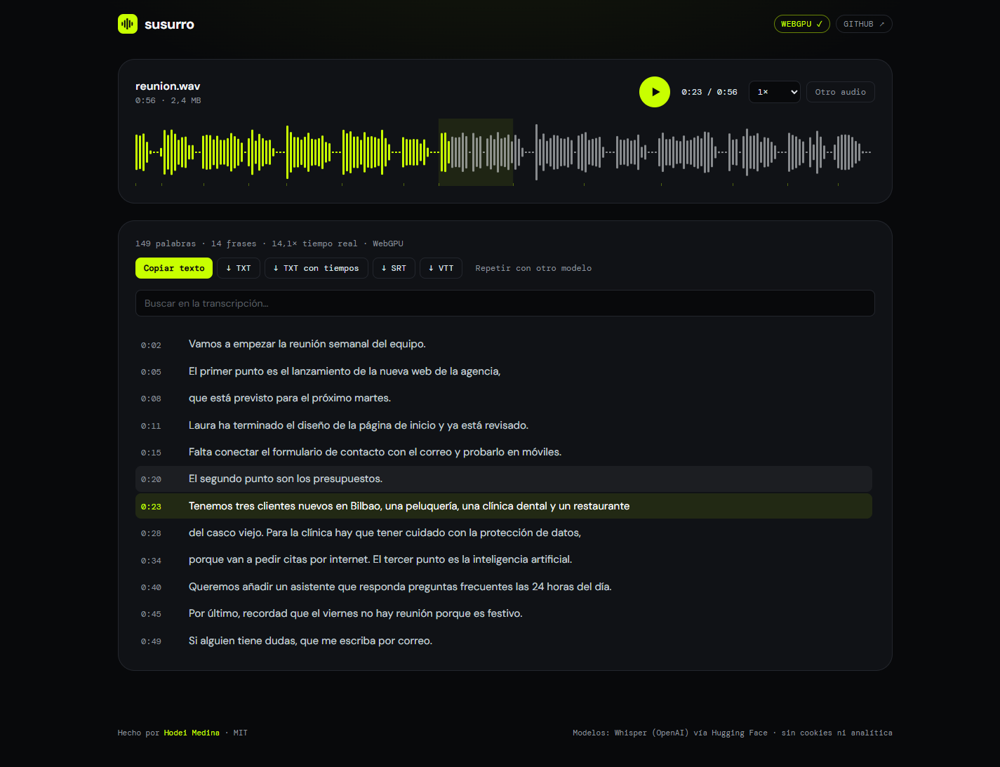

# susurro

**Transcribe audio a texto con IA sin subirlo a ningún servidor.** Whisper, el modelo de reconocimiento de voz de OpenAI, se ejecuta dentro del navegador con WebGPU o WebAssembly.

**[▶ Probar susurro](https://susurro-ia.vercel.app)**



- **Privado:** el audio nunca sale del dispositivo. Tras la primera carga funciona sin conexión.
- **Rápido:** un audio de 56 segundos se transcribe en unos 4 segundos con la tarjeta gráfica, unas 14 veces más rápido que el tiempo real, y a unas 12 veces con la CPU.
- **Útil:** acepta audios de WhatsApp, notas de voz, reuniones y vídeos, y graba desde el micrófono. Exporta a texto, texto con tiempos y subtítulos SRT y VTT. Traduce al inglés.
- **Interactivo:** onda de audio con la frase que suena resaltada, clic en una frase para escucharla, búsqueda sin tener en cuenta las tildes, corrección con doble clic y texto en vivo mientras transcribe.

## Cómo funciona

```
archivo / micrófono
   │  Web Audio API: decodifica MP3, M4A, OGG/Opus, MP4… y remuestrea a 16 kHz mono
   ▼
troceado por silencios  ── energía RMS en tramas de 20 ms, suavizada a ~200 ms;
   │                       corta en el punto más silencioso antes de 28 s
   ▼
Web Worker  ── transformers.js + ONNX Runtime (WebGPU o WASM multihilo)
   │           Whisper con marcas de tiempo; texto en vivo con WhisperTextStreamer
   ▼
segmentos con tiempo absoluto  ── limpieza de alucinaciones, solapes y duplicados
   ▼
reproductor sincronizado · búsqueda · edición · TXT / SRT / VTT
```

**Decisiones técnicas**

- **Troceado propio en vez del de la librería.** Whisper ve 30 segundos de una vez. En lugar de ventanas fijas con solapamiento, el audio se corta en los silencios. Así no se parten palabras, las marcas de tiempo son exactas, hay progreso real y se puede detener entre trozos.
- **Precisión por dispositivo.** En CPU todo va en int8. En GPU, el codificador va en fp16 si la tarjeta admite `shader-f16` (si no, en fp32) y el decodificador en q4, que es donde más se ahorra. El modelo large-v3-turbo solo se ofrece con WebGPU.
- **Aislamiento entre orígenes** con `COOP: same-origin` y `COEP: credentialless`. Activa `SharedArrayBuffer` para que WebAssembly use varios hilos, y permite seguir descargando los modelos del Hub de Hugging Face.
- **Calentamiento.** Una inferencia de un segundo de silencio compila los kernels antes del audio real, para que el texto en vivo empiece sin pausas.
- **Sin servidor ni coste.** Es una web estática. El motor de ONNX se sirve desde la propia web y los modelos se guardan en la caché del navegador.

## Modelos

| Modo | Modelo | Descarga (CPU / GPU) |
|---|---|---|
| Rápido | whisper-tiny | 41 / 96 MB |
| Equilibrado | whisper-base | 77 / 142 MB |
| Calidad | whisper-small | 249 / 299 MB |
| Máxima | whisper-large-v3-turbo | solo GPU, 759 MB |

## Desarrollo

```bash
npm install
npm run dev     # http://localhost:5173 (con cabeceras COOP/COEP)
npm test        # troceado por silencios, subtítulos, limpieza y búsqueda del segmento activo
npm run build
```

Hecho con React 19, TypeScript, Vite, Tailwind CSS 4 y [transformers.js](https://github.com/huggingface/transformers.js).

## Licencia

MIT © [Hodei Medina](https://github.com/hodeione). Los modelos Whisper son de OpenAI (licencia MIT) y se distribuyen convertidos a ONNX por la comunidad de Hugging Face.
